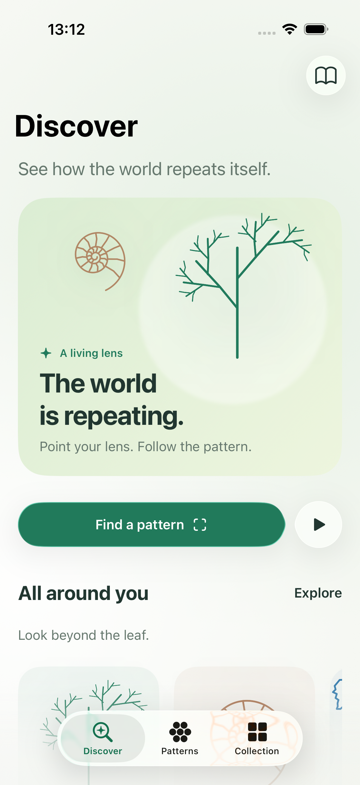
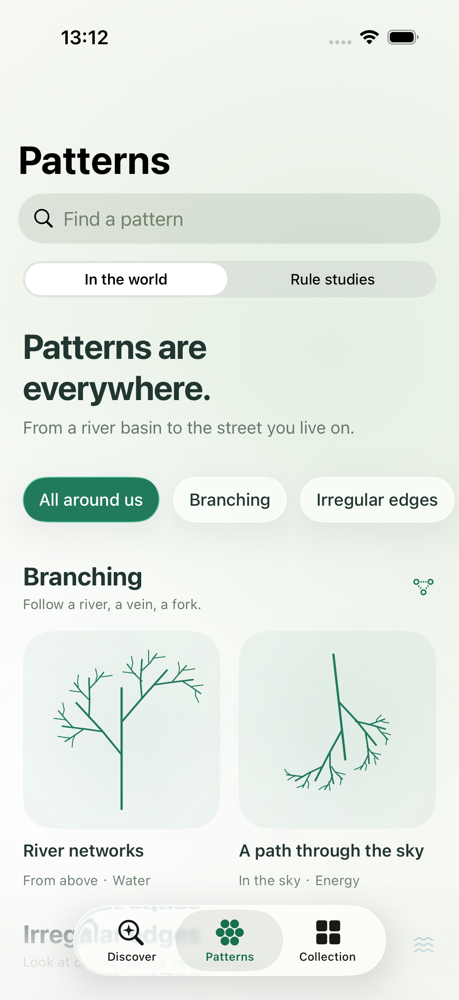
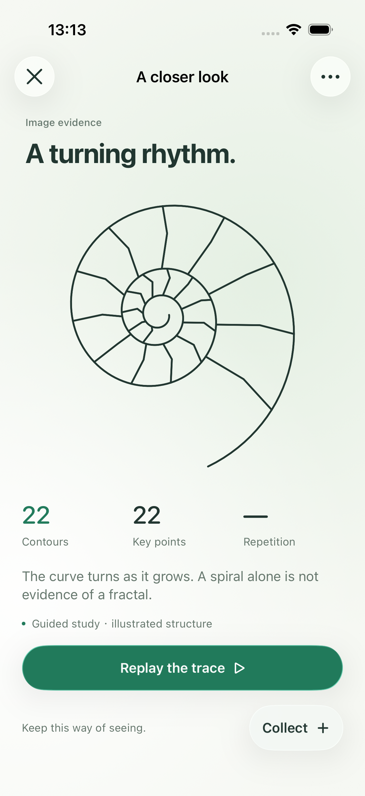

# Fractal Lens — 生活中的分形

一台观察日常结构的原生 iPhone 工具。把镜头停在一片叶子、一组窗格或一道清楚的边缘上，等待画面稳定，让表面逐渐退去，看见轮廓、重复与尺度之间的关系。再沿着结构回放，留下这一次观察。

目前处于开发阶段。英文界面、离线使用，采用近白与墨绿的视觉系统；iOS 26 使用原生 Liquid Glass，iOS 17–25 使用系统材质回退。

完整功能、交互与模块职责见 [项目说明](Documentation/PROJECT_OVERVIEW.md)。产品取舍与分析方法见 [产品判断与识别范围](Deliverables/Revision-03/PRODUCT-AND-RECOGNITION.md)。

## 预览

<p>
  
  
  
</p>

截图来自第三版模拟器验证。对应的 [实际运行录像](Deliverables/Revision-03/Live-Lens.mp4) 展示连续预览、自动捕获、冻结与结构揭示。

## 运行

使用带有 iOS 26 或更新 SDK 的 Xcode；最低运行系统为 iOS 17，仅面向 iPhone。应用无第三方运行依赖。仓库已包含生成的 Xcode 工程，可直接打开：

```bash
git clone https://github.com/tollenceld/FractalLens.git
cd FractalLens
open FractalLens.xcodeproj
```

选择 `FractalLens` scheme，运行到模拟器或 iPhone。真机运行前，在 Signing & Capabilities 中选择自己的 Team。

- **真机**：Discover → **Find a pattern**，进入持续取景。稳定的多帧证据会自动触发揭示，无需按快门。
- **模拟器**：使用明确标注的 **Guided camera preview**，自动进入教学示例；暂停按钮可让画面停留。
- **照片与标本**：**Open a photo** 导入照片，**Try a specimen** 选择植物实拍或生活场景插画。

`project.yml` 是工程配置来源。修改 target、资源归属或构建设置后，使用 `xcodegen generate` 重新生成工程。具体开发与验证命令见 [开发说明](Documentation/DEVELOPMENT.md)。

## 体验链路

See → Reveal → Understand → Replay → Collect。

先看见一个对象，再看见支撑它的结构。有可靠分枝层级时，可以进入 Whole / Branch / Twig，比较尺度、对齐局部，重放规则并改变一个参数。同尺度的重复进入 spatial repetition；普通图像展示实际轮廓与转折点，并回放提取路径。

Patterns 保留八个生活场景研究、十种逐代生成的规则模型和六张有来源记录的植物照片。Collection 保存 Moment / Structure / Glyph，并允许为同一个对象添加下一次观察。

## 证据与边界

图像标签、螺旋与普通重复都不能单独证明分形。当前版本使用 Apple Vision 提取轮廓与可选场景标签，结合几何分析寻找重复；自动分枝提取主要适用于清楚、可见的植物结构。未取得可靠层级时，不显示推测的角度、比例、递归深度或分形相似度。

连续观察至少需要四帧、持续至少 1.6 秒的稳定证据。12 秒内没有取得稳定证据，会进入清楚标注的 Guided study。教学插画、精选照片与用户实拍分别标识。

这是可运行的视觉分析原型，尚未经过专业数据集的分类准确率评测。实体 iPhone 摄像头、复杂背景、功耗、性能与完整 VoiceOver 体验仍需验证；已有测试范围见 [第三版验证记录](Deliverables/Revision-03/VERIFICATION.md)。

## 隐私

视频帧在设备上分析，视频流不保存为电影，不采集麦克风。只有点击 Collect 时才将最终图像与观察结果保存到本机 `Application Support/FractalLens`。应用无账号、上传或云同步。

## 结构与版本记录

| 路径 | 内容 |
| --- | --- |
| `FractalLens/` | SwiftUI 应用、相机、结构分析、规则模型、可视化与本地收藏 |
| `FractalLensTests/` | 分析、规则、数据兼容与持久化测试 |
| `FractalLensUITests/` | 观察、结果分流、规则研究与收藏流程测试 |
| `FractalLens.xcodeproj/` | 可直接打开的 Xcode 工程与共享 scheme |
| `project.yml` | XcodeGen 工程配置 |
| `Documentation/` | 项目说明与开发约定 |
| `Deliverables/` | 历次截图、录像、产品说明与验证记录 |
| `scripts/` | 照片结构标注、图标生成、分析缓存与模拟器录屏工具 |
| `Stories Of Plant .playgroundbook/` | 保留的原始 Playground 与规则研究 |

初始仓库记录于 **2026-10-09（Asia/Shanghai）**，对应现有第三版开发状态；它是后续修改的版本基线。历次产品变化见 [变更记录](CHANGELOG.md)。构建缓存、测试结果包和个人 Xcode 状态保留在本机。

## 素材来源

六张植物照片的作者、原始链接与许可见 [ATTRIBUTIONS.md](ATTRIBUTIONS.md)，其素材许可继续适用。生活场景插画由项目程序生成；规则研究的原始 Playground 随仓库保留。当前仓库未指定项目代码的开源许可证。
